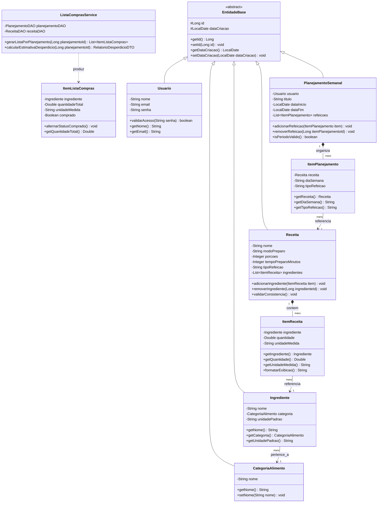

# Especificação do Back-end: PlanEat

> **Global Solution 2026/2 — CitizenTech (FIAP)**  
> **Sistema:** PlanEat — Back-end Orientado a Objetos e Persistência Nativa  
> **Linguagem:** Java 17+  
> **Persistência:** JDBC Nativo (`java.sql.*`) sem frameworks ORM  
> **Arquitetura:** Camadas bem definidas (`model`, `dao`, `service`, `controller`, `factory`, `exception`)  

---

## 1. Visão Geral e Princípios Arquiteturais

O back-end do **PlanEat** foi projetado seguindo as melhores práticas de Programação Orientada a Objetos (POO), arquitetura em camadas e padrões de projeto consolidados. Ele é responsável pelo processamento do funil **Planeja ➔ Processa ➔ Executa**, realizando a validação de regras de negócio, a persistência segura no banco relacional via JDBC e a disponibilização de uma API RESTful em formato JSON para o front-end web.

### Princípios Técnicos:
* **POO Autêntica:** Entidades de domínio ricas, protegidas por encapsulamento (atributos privados e métodos acessores/modificadores com validação) e herança a partir de uma classe base (`EntidadeBase`);
* **Persistência JDBC Nativa:** Uso direto de `ConnectionFactory`, `PreparedStatement` e `ResultSet`, prevenindo SQL Injection e controlando transações manualmente onde aplicável;
* **Separação Rígida de Responsabilidades:** Camadas fisicamente desacopladas em pacotes dedicados;
* **Tratamento Centralizado de Exceções:** Exceções de banco (`SQLException`) e violações de regras de negócio são encapsuladas em exceções de domínio expressivas.

---

## 2. Estrutura de Pacotes e Organização do Código

```
br.com.fiap.planeat
├── controller/                  # Handlers HTTP / Controladores REST
│   ├── ReceitaController.java
│   ├── IngredienteController.java
│   ├── PlanejamentoController.java
│   └── ListaComprasController.java
├── dao/                         # Acesso a Dados via JDBC Puro
│   ├── UsuarioDAO.java
│   ├── CategoriaDAO.java
│   ├── IngredienteDAO.java
│   ├── ReceitaDAO.java
│   ├── PlanejamentoDAO.java
│   └── ListaComprasDAO.java
├── dto/                         # Data Transfer Objects (transferência limpa para a API)
│   ├── ReceitaDTO.java
│   ├── ItemReceitaDTO.java
│   ├── PlanejamentoDTO.java
│   ├── ItemListaComprasDTO.java
│   └── RelatorioDesperdicioDTO.java
├── exception/                   # Exceções customizadas e gerenciador de erros
│   ├── EntidadeNaoEncontradaException.java
│   ├── RegraNegocioException.java
│   └── DatabasePersistenceException.java
├── factory/                     # Provedor centralizado de conexões
│   └── ConnectionFactory.java
├── model/                       # Entidades de Domínio com POO e Encapsulamento
│   ├── EntidadeBase.java        (Classe Abstrata com id e dataCriacao)
│   ├── Usuario.java
│   ├── CategoriaAlimento.java
│   ├── Ingrediente.java
│   ├── ItemReceita.java
│   ├── Receita.java
│   ├── PlanejamentoSemanal.java
│   ├── ItemPlanejamento.java
│   └── ItemListaCompras.java
├── service/                     # Lógica de Negócio e Consolidação Matemática
│   ├── ReceitaService.java
│   ├── PlanejamentoService.java
│   └── ListaComprasService.java
└── Main.java                    # Inicialização da aplicação e servidor HTTP
```

---

## 3. Diagrama de Classes UML (Back-end)



---

## 4. Camada de Persistência (JDBC Puro)

### 4.1. `ConnectionFactory.java`
Garante a criação padronizada e segura de conexões com o banco relacional:
```java
package br.com.fiap.planeat.factory;

import java.sql.Connection;
import java.sql.DriverManager;
import java.sql.SQLException;

public class ConnectionFactory {
    private static final String URL = "jdbc:oracle:thin:@oracle.fiap.com.br:1521:ORCL";
    private static final String USER = "rmXXXXXX";
    private static final String PASS = "XXXXXX";

    public static Connection getConnection() throws SQLException {
        try {
            Class.forName("oracle.jdbc.OracleDriver");
            return DriverManager.getConnection(URL, USER, PASS);
        } catch (ClassNotFoundException e) {
            throw new SQLException("Driver JDBC não localizado no classpath.", e);
        }
    }
}
```

### 4.2. Padrão DAO com CRUD Completo
Cada entidade principal implementa seu DAO utilizando `PreparedStatement`, garantindo:
1. `inserir(T entidade)`: Executa `INSERT` e recupera o ID gerado via `GeneratedKeys`;
2. `buscarPorId(Long id)`: Executa `SELECT` parametrizado por chave primária;
3. `listarTodos()`: Executa `SELECT` trazendo coleções mapeadas;
4. `atualizar(T entidade)`: Executa `UPDATE` condicional seguro;
5. `excluir(Long id)`: Executa `DELETE` com validação de integridade referencial.

---

## 5. Regras de Negócio e Serviços (`service`)

### 5.1. Algoritmo de Consolidação (`ListaComprasService.java`)
O serviço de lista de compras atua como o **coração do processamento inteligente**:
1. Busca todas as receitas alocadas no planejamento semanal informado;
2. Itera sobre os ingredientes de cada receita;
3. Agrupa ingredientes pelo identificador e unidade de medida em um mapa (`Map<String, ItemListaCompras>`);
4. Soma algebricamente as quantidades fracionadas dos itens idênticos;
5. Persiste a lista consolidada na tabela `T_PE_LISTA_COMPRAS` e `T_PE_ITEM_LISTA`, retornando os itens ordenados por setor/categoria.

```java
public List<ItemListaCompras> consolidarIngredientes(List<Receita> receitas) {
    Map<String, ItemListaCompras> mapaConsolidado = new LinkedHashMap<>();

    for (Receita receita : receitas) {
        for (ItemReceita item : receita.getIngredientes()) {
            String chave = item.getIngrediente().getId() + "_" + item.getUnidadeMedida().toLowerCase();
            
            if (mapaConsolidado.containsKey(chave)) {
                ItemListaCompras existente = mapaConsolidado.get(chave);
                existente.setQuantidadeTotal(existente.getQuantidadeTotal() + item.getQuantidade());
            } else {
                ItemListaCompras novo = new ItemListaCompras(
                    item.getIngrediente(),
                    item.getQuantidade(),
                    item.getUnidadeMedida(),
                    false
                );
                mapaConsolidado.put(chave, novo);
            }
        }
    }
    return new ArrayList<>(mapaConsolidado.values());
}
```

---

## 6. Endpoints da API REST (Comunicação com o Front-end)

A API fornece respostas em formato `application/json` e códigos de status HTTP semânticos (200, 201, 400, 404, 500):

| Método | Rota HTTP | Descrição | Status Sucesso |
| :--- | :--- | :--- | :--- |
| `GET` | `/api/receitas` | Retorna lista de todas as receitas cadastradas. | `200 OK` |
| `POST` | `/api/receitas` | Cadastra nova receita com sua lista de ingredientes. | `201 Created` |
| `GET` | `/api/receitas/{id}` | Retorna detalhes completos de uma receita. | `200 OK` |
| `PUT` | `/api/receitas/{id}` | Atualiza dados e ingredientes de uma receita existente. | `200 OK` |
| `DELETE` | `/api/receitas/{id}` | Remove uma receita do sistema. | `200 OK` |
| `GET` | `/api/ingredientes` | Retorna o catálogo unificado de ingredientes e categorias. | `200 OK` |
| `GET` | `/api/planejamentos` | Lista os planos alimentares do usuário. | `200 OK` |
| `POST` | `/api/planejamentos` | Cria um plano semanal alocando as refeições diárias. | `201 Created` |
| `GET` | `/api/planejamentos/{id}/lista-compras` | **Gera e retorna a lista de compras consolidada.** | `200 OK` |
| `PATCH` | `/api/itens-lista/{id}/status` | Alterna a flag de item comprado no supermercado (`S`/`N`). | `200 OK` |

### Exemplo de Payload: `POST /api/receitas`
```json
{
  "usuarioId": 1,
  "nome": "Frango Grelhado com Legumes",
  "modoPreparo": "Grelhe o frango temperado e salteie a cebola e o tomate.",
  "porcoes": 2,
  "tempoPreparoMinutos": 25,
  "tipoRefeicao": "Almoço",
  "ingredientes": [
    { "ingredienteId": 3, "quantidade": 400.0, "unidadeMedida": "g" },
    { "ingredienteId": 1, "quantidade": 150.0, "unidadeMedida": "g" },
    { "ingredienteId": 2, "quantidade": 200.0, "unidadeMedida": "g" }
  ]
}
```

### Exemplo de Payload: Retorno de Lista Consolidada
```json
{
  "planejamentoId": 1,
  "titulo": "Cardápio Semanal Consciente - Semana 1",
  "totalItens": 5,
  "itens": [
    {
      "categoria": "Hortifrúti",
      "ingredienteId": 1,
      "nome": "Cebola Roxa",
      "quantidadeTotal": 230.0,
      "unidadeMedida": "g",
      "comprado": false
    },
    {
      "categoria": "Hortifrúti",
      "ingredienteId": 2,
      "nome": "Tomate Italiano",
      "quantidadeTotal": 320.0,
      "unidadeMedida": "g",
      "comprado": true
    }
  ]
}
```

---

## 7. Tratamento de Exceções

O sistema utiliza hierarquia de exceções personalizadas para desacoplar erros de infraestrutura de violações de negócio:

1. **`DatabasePersistenceException` (Runtime):** Lançada pela camada DAO para encapsular `SQLException` e falhas de conexão;
2. **`RegraNegocioException` (Checked/Runtime):** Lançada pela camada Service para barrar violações (ex: receita sem ingredientes, quantidade zerada ou negativa, período de datas inválido);
3. **`EntidadeNaoEncontradaException`:** Retorna código HTTP `404 Not Found` quando um ID inexistente é requisitado.
