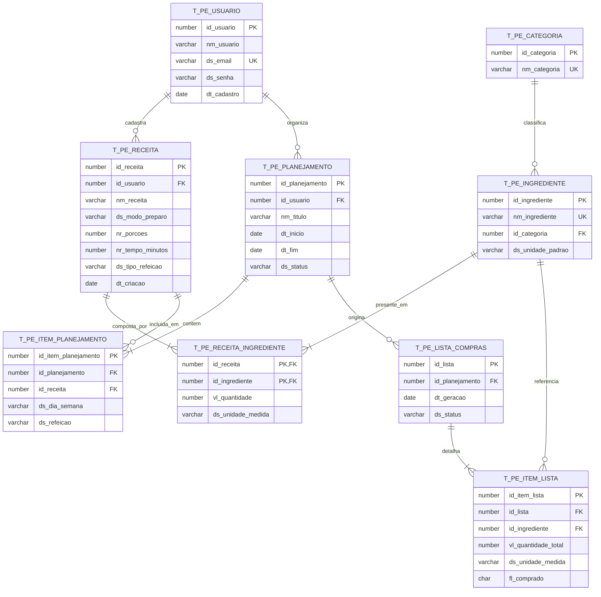

# Especificação de Banco de Dados: PlanEat

> **Global Solution 2026/2 — CitizenTech (FIAP)**  
> **Sistema:** PlanEat — Plataforma de Planejamento Alimentar e Combate ao Desperdício  
> **SGBD Alvo:** Oracle Database / PostgreSQL (Compatível com sintaxe ANSI SQL e tipos relacionais padrão)  
> **Arquivo Associado:** `script.sql`  

---

## 1. Visão Geral e Diretrizes Técnicas

A modelagem de dados do **PlanEat** foi estruturada para garantir consistência relacional rigorosa, integridade referencial e alta eficiência no processamento de consolidação de insumos alimentares.

### Requisitos Atendidos da Avaliação:
* **Mínimo de 4 tabelas interligadas:** Modeladas **9 tabelas relacionais** normalizadas até a 3ª Forma Normal (3FN);
* **Relacionamentos N:N com tabela associativa:** 
  1. `T_PE_RECEITA_INGREDIENTE` (liga `T_PE_RECEITA` a `T_PE_INGREDIENTE` com atributos de quantidade e unidade);
  2. `T_PE_ITEM_PLANEJAMENTO` (liga `T_PE_PLANEJAMENTO` a `T_PE_RECEITA` especificando dia da semana e refeição);
* **Constraints Obrigatórias:** Chaves Primárias (`PK`), Chaves Estrangeiras (`FK`), `NOT NULL`, `UNIQUE` e regras de validação via `CHECK`;
* **Script SQL Executável:** DDL completo com integridade referencial e DML com carga inicial de dados realistas;
* **Consultas Analíticas (Diferencial):** Queries de consolidação utilizando `JOIN`, `SUM`, `GROUP BY` e `ORDER BY`.

---

## 2. Diagrama Entidade-Relacionamento (DER)



---

## 3. Dicionário de Dados

### 3.1. `T_PE_USUARIO`
Armazena as informações dos cidadãos usuários da plataforma.
| Coluna | Tipo de Dado | Restrições | Descrição |
| :--- | :--- | :--- | :--- |
| `ID_USUARIO` | NUMBER | PK, NOT NULL | Identificador único do usuário. |
| `NM_USUARIO` | VARCHAR2(100) | NOT NULL | Nome completo do usuário. |
| `DS_EMAIL` | VARCHAR2(100) | UNIQUE, NOT NULL | E-mail de login e contato. |
| `DS_SENHA` | VARCHAR2(255) | NOT NULL | Hash criptográfico da senha de acesso. |
| `DT_CADASTRO` | DATE | DEFAULT SYSDATE, NOT NULL | Data e hora de criação da conta. |

### 3.2. `T_PE_CATEGORIA`
Classifica os ingredientes para facilitar a organização no supermercado (setorização).
| Coluna | Tipo de Dado | Restrições | Descrição |
| :--- | :--- | :--- | :--- |
| `ID_CATEGORIA` | NUMBER | PK, NOT NULL | Identificador único da categoria. |
| `NM_CATEGORIA` | VARCHAR2(50) | UNIQUE, NOT NULL | Nome da categoria (ex: Hortifrúti, Açougue, Mercearia). |

### 3.3. `T_PE_INGREDIENTE`
Catálogo unificado de alimentos e insumos para evitar duplicidades no momento da compra.
| Coluna | Tipo de Dado | Restrições | Descrição |
| :--- | :--- | :--- | :--- |
| `ID_INGREDIENTE` | NUMBER | PK, NOT NULL | Identificador único do ingrediente. |
| `NM_INGREDIENTE` | VARCHAR2(100) | UNIQUE, NOT NULL | Nome do ingrediente (ex: Cebola, Arroz Integral, Ovos). |
| `ID_CATEGORIA` | NUMBER | FK -> `T_PE_CATEGORIA(ID_CATEGORIA)`, NOT NULL | Categoria à qual pertence. |
| `DS_UNIDADE_PADRAO` | VARCHAR2(20) | NOT NULL | Unidade padrão recomendada (g, kg, ml, l, un). |

### 3.4. `T_PE_RECEITA`
Registra as receitas culinárias cadastradas pelo cidadão.
| Coluna | Tipo de Dado | Restrições | Descrição |
| :--- | :--- | :--- | :--- |
| `ID_RECEITA` | NUMBER | PK, NOT NULL | Identificador único da receita. |
| `ID_USUARIO` | NUMBER | FK -> `T_PE_USUARIO(ID_USUARIO)`, NOT NULL | Usuário autor da receita. |
| `NM_RECEITA` | VARCHAR2(120) | NOT NULL | Nome do prato (ex: Frango Grelhado com Legumes). |
| `DS_MODO_PREPARO` | VARCHAR2(1000) | NOT NULL | Passo a passo de preparo culinário. |
| `NR_PORCOES` | NUMBER | NOT NULL, `CHECK (NR_PORCOES > 0)` | Número de porções que a receita rende. |
| `NR_TEMPO_MINUTOS` | NUMBER | NOT NULL, `CHECK (NR_TEMPO_MINUTOS > 0)` | Tempo estimado de preparo em minutos. |
| `DS_TIPO_REFEICAO` | VARCHAR2(30) | NOT NULL | Café, Almoço, Jantar ou Lanche. |
| `DT_CRIACAO` | DATE | DEFAULT SYSDATE, NOT NULL | Data de cadastro. |

### 3.5. `T_PE_RECEITA_INGREDIENTE` (Tabela Associativa N:N)
Associa os ingredientes necessários para preparar uma receita com suas respectivas doses.
| Coluna | Tipo de Dado | Restrições | Descrição |
| :--- | :--- | :--- | :--- |
| `ID_RECEITA` | NUMBER | PK, FK -> `T_PE_RECEITA(ID_RECEITA)` | Receita correspondente. |
| `ID_INGREDIENTE` | NUMBER | PK, FK -> `T_PE_INGREDIENTE(ID_INGREDIENTE)` | Ingrediente necessário. |
| `VL_QUANTIDADE` | NUMBER(10,2) | NOT NULL, `CHECK (VL_QUANTIDADE > 0)` | Quantidade numérica do ingrediente. |
| `DS_UNIDADE_MEDIDA` | VARCHAR2(20) | NOT NULL | Unidade utilizada na receita (ex: g, kg, ml, xícara). |

### 3.6. `T_PE_PLANEJAMENTO`
Planejamento semanal ou cardápio montado pelo cidadão para um período de dias.
| Coluna | Tipo de Dado | Restrições | Descrição |
| :--- | :--- | :--- | :--- |
| `ID_PLANEJAMENTO` | NUMBER | PK, NOT NULL | Identificador único do plano alimentar. |
| `ID_USUARIO` | NUMBER | FK -> `T_PE_USUARIO(ID_USUARIO)`, NOT NULL | Cidadão responsável pelo plano. |
| `NM_TITULO` | VARCHAR2(100) | NOT NULL | Título de identificação (ex: "Semana Saudável 1"). |
| `DT_INICIO` | DATE | NOT NULL | Data de início do planejamento. |
| `DT_FIM` | DATE | NOT NULL, `CHECK (DT_FIM >= DT_INICIO)` | Data de término do planejamento. |
| `DS_STATUS` | VARCHAR2(20) | DEFAULT 'ATIVO', NOT NULL, `CHECK (DS_STATUS IN ('ATIVO', 'CONCLUIDO', 'CANCELADO'))` | Status do ciclo semanal. |

### 3.7. `T_PE_ITEM_PLANEJAMENTO` (Tabela Associativa N:N)
Aloca uma receita específica a um dia da semana e refeição dentro do plano.
| Coluna | Tipo de Dado | Restrições | Descrição |
| :--- | :--- | :--- | :--- |
| `ID_ITEM_PLANEJAMENTO` | NUMBER | PK, NOT NULL | Identificador único do item de planejamento. |
| `ID_PLANEJAMENTO` | NUMBER | FK -> `T_PE_PLANEJAMENTO(ID_PLANEJAMENTO)`, NOT NULL | Plano ao qual pertence. |
| `ID_RECEITA` | NUMBER | FK -> `T_PE_RECEITA(ID_RECEITA)`, NOT NULL | Receita a ser preparada. |
| `DS_DIA_SEMANA` | VARCHAR2(20) | NOT NULL | Segunda, Terça, Quarta, Quinta, Sexta, Sábado, Domingo. |
| `DS_REFEICAO` | VARCHAR2(30) | NOT NULL | Café da Manhã, Almoço, Jantar ou Lanche. |

### 3.8. `T_PE_LISTA_COMPRAS`
Instância consolidada da lista de compras gerada a partir de um planejamento ativo.
| Coluna | Tipo de Dado | Restrições | Descrição |
| :--- | :--- | :--- | :--- |
| `ID_LISTA` | NUMBER | PK, NOT NULL | Identificador único da lista gerada. |
| `ID_PLANEJAMENTO` | NUMBER | FK -> `T_PE_PLANEJAMENTO(ID_PLANEJAMENTO)`, NOT NULL | Planejamento que deu origem à lista. |
| `DT_GERACAO` | DATE | DEFAULT SYSDATE, NOT NULL | Momento da consolidação dos insumos. |
| `DS_STATUS` | VARCHAR2(20) | DEFAULT 'PENDENTE', NOT NULL, `CHECK (DS_STATUS IN ('PENDENTE', 'CONCLUIDA'))` | Situação da lista de compras. |

### 3.9. `T_PE_ITEM_LISTA`
Linha consolidada da lista de compras contendo a soma exata de um ingrediente e o status de checagem.
| Coluna | Tipo de Dado | Restrições | Descrição |
| :--- | :--- | :--- | :--- |
| `ID_ITEM_LISTA` | NUMBER | PK, NOT NULL | Identificador do item consolidado. |
| `ID_LISTA` | NUMBER | FK -> `T_PE_LISTA_COMPRAS(ID_LISTA)`, NOT NULL | Lista de compras vinculada. |
| `ID_INGREDIENTE` | NUMBER | FK -> `T_PE_INGREDIENTE(ID_INGREDIENTE)`, NOT NULL | Ingrediente a comprar. |
| `VL_QUANTIDADE_TOTAL` | NUMBER(10,2) | NOT NULL, `CHECK (VL_QUANTIDADE_TOTAL > 0)` | Soma acumulada exata do ingrediente. |
| `DS_UNIDADE_MEDIDA` | VARCHAR2(20) | NOT NULL | Unidade de medida consolidada. |
| `FL_COMPRADO` | CHAR(1) | DEFAULT 'N', NOT NULL, `CHECK (FL_COMPRADO IN ('S', 'N'))` | Flag tátil de item já colocado no carrinho ('S'/'N'). |

---

## 4. Script SQL Completo (`script.sql`)

```sql
-- ============================================================================
-- SCRIPT DE CRIAÇÃO E CARGA INICIAL: PlanEat (CitizenTech - FIAP)
-- ============================================================================

-- 1. LIMPEZA PREVENTIVA DAS TABELAS (Ordem reversa de dependência)
DROP TABLE T_PE_ITEM_LISTA CASCADE CONSTRAINTS;
DROP TABLE T_PE_LISTA_COMPRAS CASCADE CONSTRAINTS;
DROP TABLE T_PE_ITEM_PLANEJAMENTO CASCADE CONSTRAINTS;
DROP TABLE T_PE_PLANEJAMENTO CASCADE CONSTRAINTS;
DROP TABLE T_PE_RECEITA_INGREDIENTE CASCADE CONSTRAINTS;
DROP TABLE T_PE_RECEITA CASCADE CONSTRAINTS;
DROP TABLE T_PE_INGREDIENTE CASCADE CONSTRAINTS;
DROP TABLE T_PE_CATEGORIA CASCADE CONSTRAINTS;
DROP TABLE T_PE_USUARIO CASCADE CONSTRAINTS;

-- 2. CRIAÇÃO DAS TABELAS COM CONSTRAINTS

-- T_PE_USUARIO
CREATE TABLE T_PE_USUARIO (
    ID_USUARIO NUMBER GENERATED BY DEFAULT AS IDENTITY,
    NM_USUARIO VARCHAR2(100) NOT NULL,
    DS_EMAIL VARCHAR2(100) NOT NULL,
    DS_SENHA VARCHAR2(255) NOT NULL,
    DT_CADASTRO DATE DEFAULT SYSDATE NOT NULL,
    CONSTRAINT PK_PE_USUARIO PRIMARY KEY (ID_USUARIO),
    CONSTRAINT UK_PE_USUARIO_EMAIL UNIQUE (DS_EMAIL)
);

-- T_PE_CATEGORIA
CREATE TABLE T_PE_CATEGORIA (
    ID_CATEGORIA NUMBER GENERATED BY DEFAULT AS IDENTITY,
    NM_CATEGORIA VARCHAR2(50) NOT NULL,
    CONSTRAINT PK_PE_CATEGORIA PRIMARY KEY (ID_CATEGORIA),
    CONSTRAINT UK_PE_CATEGORIA_NOME UNIQUE (NM_CATEGORIA)
);

-- T_PE_INGREDIENTE
CREATE TABLE T_PE_INGREDIENTE (
    ID_INGREDIENTE NUMBER GENERATED BY DEFAULT AS IDENTITY,
    NM_INGREDIENTE VARCHAR2(100) NOT NULL,
    ID_CATEGORIA NUMBER NOT NULL,
    DS_UNIDADE_PADRAO VARCHAR2(20) NOT NULL,
    CONSTRAINT PK_PE_INGREDIENTE PRIMARY KEY (ID_INGREDIENTE),
    CONSTRAINT UK_PE_INGREDIENTE_NOME UNIQUE (NM_INGREDIENTE),
    CONSTRAINT FK_PE_ING_CATEGORIA FOREIGN KEY (ID_CATEGORIA) 
        REFERENCES T_PE_CATEGORIA (ID_CATEGORIA)
);

-- T_PE_RECEITA
CREATE TABLE T_PE_RECEITA (
    ID_RECEITA NUMBER GENERATED BY DEFAULT AS IDENTITY,
    ID_USUARIO NUMBER NOT NULL,
    NM_RECEITA VARCHAR2(120) NOT NULL,
    DS_MODO_PREPARO VARCHAR2(1000) NOT NULL,
    NR_PORCOES NUMBER NOT NULL,
    NR_TEMPO_MINUTOS NUMBER NOT NULL,
    DS_TIPO_REFEICAO VARCHAR2(30) NOT NULL,
    DT_CRIACAO DATE DEFAULT SYSDATE NOT NULL,
    CONSTRAINT PK_PE_RECEITA PRIMARY KEY (ID_RECEITA),
    CONSTRAINT FK_PE_REC_USUARIO FOREIGN KEY (ID_USUARIO) 
        REFERENCES T_PE_USUARIO (ID_USUARIO),
    CONSTRAINT CK_PE_REC_PORCOES CHECK (NR_PORCOES > 0),
    CONSTRAINT CK_PE_REC_TEMPO CHECK (NR_TEMPO_MINUTOS > 0)
);

-- T_PE_RECEITA_INGREDIENTE (Associativa N:N)
CREATE TABLE T_PE_RECEITA_INGREDIENTE (
    ID_RECEITA NUMBER NOT NULL,
    ID_INGREDIENTE NUMBER NOT NULL,
    VL_QUANTIDADE NUMBER(10,2) NOT NULL,
    DS_UNIDADE_MEDIDA VARCHAR2(20) NOT NULL,
    CONSTRAINT PK_PE_REC_ING PRIMARY KEY (ID_RECEITA, ID_INGREDIENTE),
    CONSTRAINT FK_PE_RI_RECEITA FOREIGN KEY (ID_RECEITA) 
        REFERENCES T_PE_RECEITA (ID_RECEITA) ON DELETE CASCADE,
    CONSTRAINT FK_PE_RI_INGREDIENTE FOREIGN KEY (ID_INGREDIENTE) 
        REFERENCES T_PE_INGREDIENTE (ID_INGREDIENTE),
    CONSTRAINT CK_PE_RI_QTD CHECK (VL_QUANTIDADE > 0)
);

-- T_PE_PLANEJAMENTO
CREATE TABLE T_PE_PLANEJAMENTO (
    ID_PLANEJAMENTO NUMBER GENERATED BY DEFAULT AS IDENTITY,
    ID_USUARIO NUMBER NOT NULL,
    NM_TITULO VARCHAR2(100) NOT NULL,
    DT_INICIO DATE NOT NULL,
    DT_FIM DATE NOT NULL,
    DS_STATUS VARCHAR2(20) DEFAULT 'ATIVO' NOT NULL,
    CONSTRAINT PK_PE_PLANEJAMENTO PRIMARY KEY (ID_PLANEJAMENTO),
    CONSTRAINT FK_PE_PLAN_USUARIO FOREIGN KEY (ID_USUARIO) 
        REFERENCES T_PE_USUARIO (ID_USUARIO),
    CONSTRAINT CK_PE_PLAN_DATAS CHECK (DT_FIM >= DT_INICIO),
    CONSTRAINT CK_PE_PLAN_STATUS CHECK (DS_STATUS IN ('ATIVO', 'CONCLUIDO', 'CANCELADO'))
);

-- T_PE_ITEM_PLANEJAMENTO (Associativa N:N)
CREATE TABLE T_PE_ITEM_PLANEJAMENTO (
    ID_ITEM_PLANEJAMENTO NUMBER GENERATED BY DEFAULT AS IDENTITY,
    ID_PLANEJAMENTO NUMBER NOT NULL,
    ID_RECEITA NUMBER NOT NULL,
    DS_DIA_SEMANA VARCHAR2(20) NOT NULL,
    DS_REFEICAO VARCHAR2(30) NOT NULL,
    CONSTRAINT PK_PE_ITEM_PLAN PRIMARY KEY (ID_ITEM_PLANEJAMENTO),
    CONSTRAINT FK_PE_IP_PLANEJAMENTO FOREIGN KEY (ID_PLANEJAMENTO) 
        REFERENCES T_PE_PLANEJAMENTO (ID_PLANEJAMENTO) ON DELETE CASCADE,
    CONSTRAINT FK_PE_IP_RECEITA FOREIGN KEY (ID_RECEITA) 
        REFERENCES T_PE_RECEITA (ID_RECEITA)
);

-- T_PE_LISTA_COMPRAS
CREATE TABLE T_PE_LISTA_COMPRAS (
    ID_LISTA NUMBER GENERATED BY DEFAULT AS IDENTITY,
    ID_PLANEJAMENTO NUMBER NOT NULL,
    DT_GERACAO DATE DEFAULT SYSDATE NOT NULL,
    DS_STATUS VARCHAR2(20) DEFAULT 'PENDENTE' NOT NULL,
    CONSTRAINT PK_PE_LISTA PRIMARY KEY (ID_LISTA),
    CONSTRAINT FK_PE_LISTA_PLAN FOREIGN KEY (ID_PLANEJAMENTO) 
        REFERENCES T_PE_PLANEJAMENTO (ID_PLANEJAMENTO) ON DELETE CASCADE,
    CONSTRAINT CK_PE_LISTA_STATUS CHECK (DS_STATUS IN ('PENDENTE', 'CONCLUIDA'))
);

-- T_PE_ITEM_LISTA
CREATE TABLE T_PE_ITEM_LISTA (
    ID_ITEM_LISTA NUMBER GENERATED BY DEFAULT AS IDENTITY,
    ID_LISTA NUMBER NOT NULL,
    ID_INGREDIENTE NUMBER NOT NULL,
    VL_QUANTIDADE_TOTAL NUMBER(10,2) NOT NULL,
    DS_UNIDADE_MEDIDA VARCHAR2(20) NOT NULL,
    FL_COMPRADO CHAR(1) DEFAULT 'N' NOT NULL,
    CONSTRAINT PK_PE_ITEM_LISTA PRIMARY KEY (ID_ITEM_LISTA),
    CONSTRAINT FK_PE_IL_LISTA FOREIGN KEY (ID_LISTA) 
        REFERENCES T_PE_LISTA_COMPRAS (ID_LISTA) ON DELETE CASCADE,
    CONSTRAINT FK_PE_IL_INGREDIENTE FOREIGN KEY (ID_INGREDIENTE) 
        REFERENCES T_PE_INGREDIENTE (ID_INGREDIENTE),
    CONSTRAINT CK_PE_IL_QTD CHECK (VL_QUANTIDADE_TOTAL > 0),
    CONSTRAINT CK_PE_IL_FLAG CHECK (FL_COMPRADO IN ('S', 'N'))
);

-- ============================================================================
-- 3. CARGA DE DADOS INICIAL (DML)
-- ============================================================================

-- Usuários
INSERT INTO T_PE_USUARIO (NM_USUARIO, DS_EMAIL, DS_SENHA) 
VALUES ('Carlos Eduardo Mendes', 'carlos.mendes@email.com', '$2a$12$e8YvXmK.D9J9d9Z7yY.cRe');

-- Categorias de Alimentos
INSERT INTO T_PE_CATEGORIA (NM_CATEGORIA) VALUES ('Hortifrúti');
INSERT INTO T_PE_CATEGORIA (NM_CATEGORIA) VALUES ('Açougue & Peixaria');
INSERT INTO T_PE_CATEGORIA (NM_CATEGORIA) VALUES ('Mercearia & Grãos');
INSERT INTO T_PE_CATEGORIA (NM_CATEGORIA) VALUES ('Laticínios & Ovos');
INSERT INTO T_PE_CATEGORIA (NM_CATEGORIA) VALUES ('Temperos & Especiarias');

-- Ingredientes
INSERT INTO T_PE_INGREDIENTE (NM_INGREDIENTE, ID_CATEGORIA, DS_UNIDADE_PADRAO) VALUES ('Cebola Roxa', 1, 'g');
INSERT INTO T_PE_INGREDIENTE (NM_INGREDIENTE, ID_CATEGORIA, DS_UNIDADE_PADRAO) VALUES ('Tomate Italiano', 1, 'g');
INSERT INTO T_PE_INGREDIENTE (NM_INGREDIENTE, ID_CATEGORIA, DS_UNIDADE_PADRAO) VALUES ('Peito de Frango', 2, 'g');
INSERT INTO T_PE_INGREDIENTE (NM_INGREDIENTE, ID_CATEGORIA, DS_UNIDADE_PADRAO) VALUES ('Arroz Integral', 3, 'g');
INSERT INTO T_PE_INGREDIENTE (NM_INGREDIENTE, ID_CATEGORIA, DS_UNIDADE_PADRAO) VALUES ('Azeite de Oliva Extra Virgem', 3, 'ml');
INSERT INTO T_PE_INGREDIENTE (NM_INGREDIENTE, ID_CATEGORIA, DS_UNIDADE_PADRAO) VALUES ('Ovos Caipiras', 4, 'un');

-- Receitas
INSERT INTO T_PE_RECEITA (ID_USUARIO, NM_RECEITA, DS_MODO_PREPARO, NR_PORCOES, NR_TEMPO_MINUTOS, DS_TIPO_REFEICAO)
VALUES (1, 'Frango Grelhado com Tomate e Cebola', 'Tempere o frango com azeite. Grelhe e refogue os tomates e cebolas fatiadas.', 2, 25, 'Almoço');

INSERT INTO T_PE_RECEITA (ID_USUARIO, NM_RECEITA, DS_MODO_PREPARO, NR_PORCOES, NR_TEMPO_MINUTOS, DS_TIPO_REFEICAO)
VALUES (1, 'Omelete Nutritiva de Tomate', 'Bata os ovos, pique o tomate e a cebola. Cozinhe em frigideira antiaderente.', 1, 15, 'Jantar');

-- Ingredientes das Receitas (Demonstra o N:N)
-- Receita 1: Frango com Legumes
INSERT INTO T_PE_RECEITA_INGREDIENTE (ID_RECEITA, ID_INGREDIENTE, VL_QUANTIDADE, DS_UNIDADE_MEDIDA) VALUES (1, 3, 400.00, 'g');
INSERT INTO T_PE_RECEITA_INGREDIENTE (ID_RECEITA, ID_INGREDIENTE, VL_QUANTIDADE, DS_UNIDADE_MEDIDA) VALUES (1, 1, 150.00, 'g');
INSERT INTO T_PE_RECEITA_INGREDIENTE (ID_RECEITA, ID_INGREDIENTE, VL_QUANTIDADE, DS_UNIDADE_MEDIDA) VALUES (1, 2, 200.00, 'g');
INSERT INTO T_PE_RECEITA_INGREDIENTE (ID_RECEITA, ID_INGREDIENTE, VL_QUANTIDADE, DS_UNIDADE_MEDIDA) VALUES (1, 5, 20.00, 'ml');

-- Receita 2: Omelete (Compartilha Cebola e Tomate!)
INSERT INTO T_PE_RECEITA_INGREDIENTE (ID_RECEITA, ID_INGREDIENTE, VL_QUANTIDADE, DS_UNIDADE_MEDIDA) VALUES (2, 6, 3.00, 'un');
INSERT INTO T_PE_RECEITA_INGREDIENTE (ID_RECEITA, ID_INGREDIENTE, VL_QUANTIDADE, DS_UNIDADE_MEDIDA) VALUES (2, 1, 80.00, 'g');
INSERT INTO T_PE_RECEITA_INGREDIENTE (ID_RECEITA, ID_INGREDIENTE, VL_QUANTIDADE, DS_UNIDADE_MEDIDA) VALUES (2, 2, 120.00, 'g');

-- Planejamento Semanal
INSERT INTO T_PE_PLANEJAMENTO (ID_USUARIO, NM_TITULO, DT_INICIO, DT_FIM, DS_STATUS)
VALUES (1, 'Cardápio Semanal Consciente - Semana 1', TO_DATE('2026-11-10', 'YYYY-MM-DD'), TO_DATE('2026-11-16', 'YYYY-MM-DD'), 'ATIVO');

-- Refeições do Planejamento
INSERT INTO T_PE_ITEM_PLANEJAMENTO (ID_PLANEJAMENTO, ID_RECEITA, DS_DIA_SEMANA, DS_REFEICAO) VALUES (1, 1, 'Segunda-feira', 'Almoço');
INSERT INTO T_PE_ITEM_PLANEJAMENTO (ID_PLANEJAMENTO, ID_RECEITA, DS_DIA_SEMANA, DS_REFEICAO) VALUES (1, 2, 'Segunda-feira', 'Jantar');
INSERT INTO T_PE_ITEM_PLANEJAMENTO (ID_PLANEJAMENTO, ID_RECEITA, DS_DIA_SEMANA, DS_REFEICAO) VALUES (1, 1, 'Quarta-feira', 'Almoço');

COMMIT;
```

---

## 5. Consultas SQL Analíticas (Diferenciais de Avaliação)

### 5.1. Agregação Inteligente de Compras por Planejamento
Essa consulta calcula a **soma unificada exata de insumos** necessários para todas as refeições do planejamento selecionado, agrupando por setor do mercado e eliminando duplicidades:

```sql
SELECT 
    c.NM_CATEGORIA AS CATEGORIA_MERCADO,
    i.ID_INGREDIENTE,
    i.NM_INGREDIENTE AS ALIMENTO,
    SUM(ri.VL_QUANTIDADE) AS QUANTIDADE_TOTAL,
    ri.DS_UNIDADE_MEDIDA AS UNIDADE,
    COUNT(DISTINCT r.ID_RECEITA) AS TOTAL_RECEITAS_QUE_UTILIZAM
FROM T_PE_PLANEJAMENTO p
JOIN T_PE_ITEM_PLANEJAMENTO ip ON p.ID_PLANEJAMENTO = ip.ID_PLANEJAMENTO
JOIN T_PE_RECEITA r ON ip.ID_RECEITA = r.ID_RECEITA
JOIN T_PE_RECEITA_INGREDIENTE ri ON r.ID_RECEITA = ri.ID_RECEITA
JOIN T_PE_INGREDIENTE i ON ri.ID_INGREDIENTE = i.ID_INGREDIENTE
JOIN T_PE_CATEGORIA c ON i.ID_CATEGORIA = c.ID_CATEGORIA
WHERE p.ID_PLANEJAMENTO = 1
GROUP BY 
    c.NM_CATEGORIA,
    i.ID_INGREDIENTE,
    i.NM_INGREDIENTE,
    ri.DS_UNIDADE_MEDIDA
ORDER BY 
    c.NM_CATEGORIA ASC,
    i.NM_INGREDIENTE ASC;
```

### 5.2. Relatório de Desperdício Evitado e Aproveitamento de Insumos
Mede o impacto CitizenTech identificando quais ingredientes foram reaproveitados em múltiplas receitas na mesma semana, evitando compras em porções fechadas excedentes:

```sql
SELECT 
    i.NM_INGREDIENTE,
    c.NM_CATEGORIA,
    COUNT(ip.ID_ITEM_PLANEJAMENTO) AS FREQUENCIA_NO_CARDAPIO,
    SUM(ri.VL_QUANTIDADE) AS CONSUMO_TOTAL_PLANEJADO,
    ri.DS_UNIDADE_MEDIDA,
    CASE 
        WHEN COUNT(ip.ID_ITEM_PLANEJAMENTO) > 1 THEN 'Alto Aproveitamento (Desperdício Zero)'
        ELSE 'Item Pontual'
    END AS INDICADOR_CONSUMO_CONSCIENTE
FROM T_PE_PLANEJAMENTO p
JOIN T_PE_ITEM_PLANEJAMENTO ip ON p.ID_PLANEJAMENTO = ip.ID_PLANEJAMENTO
JOIN T_PE_RECEITA_INGREDIENTE ri ON ip.ID_RECEITA = ri.ID_RECEITA
JOIN T_PE_INGREDIENTE i ON ri.ID_INGREDIENTE = i.ID_INGREDIENTE
JOIN T_PE_CATEGORIA c ON i.ID_CATEGORIA = c.ID_CATEGORIA
WHERE p.ID_PLANEJAMENTO = 1
GROUP BY 
    i.NM_INGREDIENTE,
    c.NM_CATEGORIA,
    ri.DS_UNIDADE_MEDIDA
ORDER BY FREQUENCIA_NO_CARDAPIO DESC;
```
