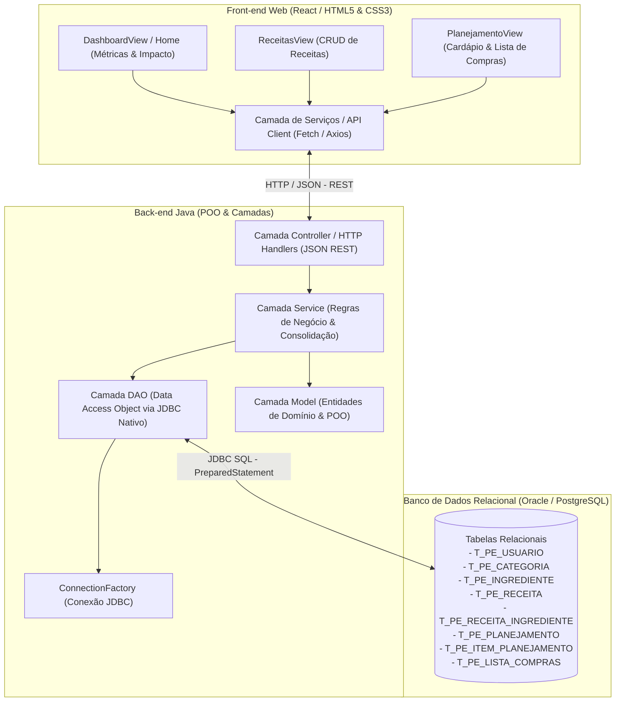

# Especificação Geral do Projeto: PlanEat

> **Global Solution 2026/2 — CitizenTech**  
> **Curso:** Engenharia de Software — 2º Ano (FIAP)  
> **Tema:** CitizenTech — Tecnologia com o cidadão no centro da inovação  
> **Objetivos de Desenvolvimento Sustentável (ODS):** ODS 2 (Fome Zero e Agricultura Sustentável) e ODS 11 (Cidades e Comunidades Sustentáveis)  
> **Período da Sprint:** 04/11/2026 a 19/11/2026  

---

## 📚 Documentação Técnica Especializada

A documentação do PlanEat foi modularizada em documentos dedicados para cada pilar da solução:

| Módulo | Documento de Referência | Descrição |
| :--- | :--- | :--- |
| 🗄️ **Banco de Dados** | [`docs/banco.md`](/docs/banco.md) | Diagrama ER, dicionário de dados, script DDL/DML (`script.sql`) e consultas analíticas. |
| ☕ **Back-end Java** | [`docs/backend.md`](/docs/backend.md) | Arquitetura em camadas, POO, Diagrama de Classes UML, persistência JDBC nativa e regras de negócio. |
| ⚛️ **Front-end React** | [`docs/frontend.md`](/docs/frontend.md) | SPA em React, componentes, rotas, checklist tátil para compras e integração com a API. |

---

## 1. Visão Geral do Produto (Product Vision)

### 1.1. Contexto e Motivação
No Brasil, cerca de **27 milhões de toneladas de alimentos são desperdiçadas anualmente**, e aproximadamente **60% desse volume ocorre dentro dos lares dos próprios cidadãos** (dados PNUMA / FAO). 

A causa primária do desperdício doméstico decorre de:
1. **Compras por impulso:** Ida ao supermercado sem lista objetiva e estruturada;
2. **Ausência de planejamento semanal:** Falta de clareza sobre o cardápio e refeições dos dias seguintes;
3. **Superestimação de porções:** Compra de quantidades acima do consumo real ("cultura da fartura"), levando alimentos perecíveis a apodrecerem na geladeira ou despensa.

### 1.2. Proposta de Valor: PlanEat
O **PlanEat** é uma plataforma web CitizenTech voltada para o consumo consciente e planejamento alimentar doméstico. O sistema automatiza o funil de consumo em **3 etapas**:
* **1. Planeja:** O cidadão cadastra suas receitas favoritas e estrutura seu cardápio/dieta para a semana;
* **2. Processa:** O sistema cruza os ingredientes necessários em cada refeição planejada e consolida automaticamente os itens e quantidades, eliminando duplicidades e calculando a porção exata;
* **3. Executa:** O usuário utiliza uma lista de compras inteligente, interativa e responsiva no celular durante a ida ao supermercado, comprando estritamente o necessário.

### 1.3. Cidadão Beneficiado (Público-Alvo)
* Pessoas que moram sozinhas e possuem rotina corrida com pouco tempo para gerenciar despensa;
* Jovens adultos em fase de transição e gestão domiciliar independente;
* Responsáveis pelo orçamento doméstico e compras de pequenos domicílios que buscam economia financeira e redução do lixo orgânico.

---

## 2. Requisitos do Sistema

### 2.1. Requisitos Funcionais (RF)

| ID | Módulo | Descrição do Requisito | Prioridade |
| :--- | :--- | :--- | :--- |
| **RF01** | Autenticação & Perfil | Permitir cadastro, autenticação (login) e gerenciamento de perfil do cidadão. | Essencial |
| **RF02** | Ingredientes & Categorias | Manter cadastro de ingredientes com nome, categoria (Hortifrúti, Carnes, Grãos, Laticínios, Mercearia) e unidade de medida padrão (g, kg, ml, l, un). | Essencial |
| **RF03** | Gestão de Receitas | Permitir o CRUD completo (criar, visualizar, listar, editar e remover) de receitas culinárias. | Essencial |
| **RF04** | Composição da Receita | Associar múltiplos ingredientes a uma receita, definindo quantidade e unidade específica para o rendimento de porções. | Essencial |
| **RF05** | Dietas & Planejamento Semanal | Permitir que o usuário monte um plano alimentar (dieta da semana), definindo quais receitas serão preparadas em cada dia e tipo de refeição (Café, Almoço, Jantar, Lanche). | Essencial |
| **RF06** | Motor de Geração de Lista de Compras | Processar o planejamento da semana e gerar a lista de compras consolidada, somando as quantidades de ingredientes idênticos com mesma unidade de medida. | Essencial |
| **RF07** | Checklist Interativo de Compras | Permitir que o usuário marque e desmarque itens comprados diretamente na tela da lista em tempo real. | Essencial |
| **RF08** | Relatório de Desperdício Evitado | Exibir indicador estatístico de alimentos e porções economizadas com base nos itens planejados vs. comprados. | Diferencial |
| **RF09** | Exportação / Compartilhamento | Permitir a cópia ou exportação do texto resumido da lista de compras para envio via WhatsApp ou bloco de notas. | Desejável |

### 2.2. Requisitos Não Funcionais (RNF)

| ID | Categoria | Descrição do Requisito |
| :--- | :--- | :--- |
| **RNF01** | Arquitetura | Back-end obrigatoriamente desenvolvido em **Java** com rigorosa Programação Orientada a Objetos (POO), arquitetura em camadas (`model`, `dao`, `service`, `controller`/`resource`). |
| **RNF02** | Persistência | Persistência relacional utilizando **JDBC nativo** (`PreparedStatement`, `ResultSet`, `ConnectionFactory`), sem frameworks ORM pesados, garantindo entendimento dos fundamentos. |
| **RNF03** | Banco de Dados | Banco de dados relacional (Oracle, PostgreSQL ou MySQL) com integridade referencial (PK, FK), constraints (`NOT NULL`, `CHECK`, `UNIQUE`) e script `.sql` completo com carga inicial. |
| **RNF04** | Interface Web | Front-end construído em **React** (SPA modular com React Router, componentes funcionais e hooks) garantindo layout responsivo e mobile-first. |
| **RNF05** | Responsividade | Design responsivo com abordagem *mobile-first*, garantindo legibilidade e usabilidade tátil no smartphone enquanto o usuário percorre os corredores do supermercado. |
| **RNF06** | Integração Web-Back | **Diferencial Global Solution:** O front-end web deve se comunicar com o back-end Java via requisições HTTP (API REST com JSON via `fetch`/`axios`), lendo e gravando dados reais do banco. |
| **RNF07** | Tratamento de Falhas | Tratamento estruturado de exceções (`SQLException`, validações de negócio) com retorno de mensagens amigáveis na interface, impedindo que a aplicação trave. |
| **RNF08** | Consultas Analíticas | Uso de consultas SQL avançadas com `JOIN`, `SUM`, `GROUP BY` e ordenação para agregação da lista de compras e relatórios gerenciais. |

### 2.3. Regras de Negócio (RN)

* **RN01 (Consolidação de Ingredientes):** Quando duas ou mais receitas do planejamento utilizarem o mesmo ingrediente e a mesma unidade de medida (ex: 300g de cebola em uma receita e 200g em outra), a lista de compras deve unificar o item com a soma total (500g de cebola).
* **RN02 (Validação de Porções):** O número de porções de uma receita deve ser sempre um número inteiro estritamente positivo ($> 0$).
* **RN03 (Unicidade de Ingrediente):** O nome do ingrediente deve ser único no catálogo do sistema (case-insensitive) para prevenir cadastros ambíguos.
* **RN04 (Integridade do Planejamento):** Não é permitida a exclusão de uma receita que esteja vinculada a um planejamento semanal ativo sem aviso de desassociação prévia.
* **RN05 (Consistência das Unidades):** Caso um mesmo ingrediente seja cadastrado em unidades incompatíveis (ex: gramas e unidades avulsas), a lista deve exibir as linhas separadas identificando a unidade correspondente.

---

## 3. Visão Geral da Arquitetura do Sistema

---

## 4. Síntese dos Pilares do Projeto

### 4.1. Banco de Dados Relacional
O banco foi modelado com 9 tabelas relacionais contendo chaves primárias, estrangeiras e duas tabelas associativas N:N (`T_PE_RECEITA_INGREDIENTE` e `T_PE_ITEM_PLANEJAMENTO`).  
👉 *Consulte o documento completo:* [`docs/banco.md`](/docs/banco.md) para o Diagrama Entidade-Relacionamento, Dicionário de Dados, script SQL executável (`CREATE TABLE` e `INSERT`) e consultas analíticas de agregação.

### 4.2. Back-end em Java com Persistência
Construído com Programação Orientada a Objetos rigorosa, herança de classe base, encapsulamento e camadas desacopladas (`model`, `dao`, `service`, `controller`, `factory`, `exception`). A persistência é realizada exclusivamente via JDBC nativo sem ORM.  
👉 *Consulte o documento completo:* [`docs/backend.md`](/docs/backend.md) para o Diagrama de Classes UML, estrutura de pacotes, rotas REST, contratos JSON e algoritmo de consolidação.

### 4.3. Front-end em React
Single Page Application (SPA) desenvolvida em React com Vite e React Router, contendo 3 visões principais interligadas (`/`, `/receitas`, `/planejamento`), validações de formulário e um checklist tátil desenhado para utilização direta no smartphone durante as compras.  
👉 *Consulte o documento completo:* [`docs/frontend.md`](/docs/frontend.md) para detalhes de componentes, fluxos de tela, estilização mobile-first e integração via Fetch/Axios.

---

## 5. Endpoints da API REST (Integração Front ⟷ Back)

| Método | Endpoint | Descrição |
| :--- | :--- | :--- |
| `GET` | `/api/receitas` | Retorna lista de todas as receitas em JSON. |
| `POST` | `/api/receitas` | Cria nova receita com seus ingredientes associados. |
| `GET` | `/api/receitas/{id}` | Retorna detalhes completos de uma receita. |
| `PUT` | `/api/receitas/{id}` | Atualiza dados de uma receita existente. |
| `DELETE` | `/api/receitas/{id}` | Remove uma receita do sistema. |
| `GET` | `/api/ingredientes` | Retorna catálogo de ingredientes e categorias. |
| `GET` | `/api/planejamentos` | Retorna os planos semanais cadastrados. |
| `POST` | `/api/planejamentos` | Salva um novo planejamento semanal com as refeições. |
| `GET` | `/api/planejamentos/{id}/lista-compras` | **Processamento inteligente:** Executa a consulta SQL consolidada e retorna a lista de compras unificada. |
| `PATCH` | `/api/itens-lista/{id}/status` | Alterna o status de item comprado ('S'/'N') no supermercado. |

---

## 6. Alinhamento com Critérios de Avaliação (Global Solution FIAP)

| Critério Avaliado | Exigência da FIAP | Como o PlanEat Cumpre |
| :--- | :--- | :--- |
| **POO de Verdade** | 3+ entidades relacionadas, encapsuladas, com herança ou interfaces. | Classes `Usuario`, `Receita`, `Ingrediente`, `ItemReceita`, `PlanejamentoSemanal` e `ItemPlanejamento` herdando de classe base com encapsulamento rigoroso e validações internas. |
| **CRUD via JDBC** | Operações de Inserção, Consulta, Atualização e Exclusão sem ORM. | DAOs dedicados realizando operações completas via `PreparedStatement` e conexão nativa. |
| **Camadas Separadas** | Pacotes dedicados para Model, DAO, Service e Controller/View. | Separação física e lógica estrita em pacotes `model`, `dao`, `service`, `controller`, `factory` e `exception`. |
| **Tratamento de Erros** | Tratamento seguro de exceções de banco e entradas inválidas. | Exceções de persistência e negócio tratadas e convertidas em respostas informativas com códigos HTTP. |
| **Modelagem do Banco** | Mínimo 4 tabelas, PK, FK, cardinalidades e relacionamento N:N. | 9 tabelas relacionais com PK, FK, UNIQUE, CHECK e 2 relacionamentos N:N associativos (`T_PE_RECEITA_INGREDIENTE` e `T_PE_ITEM_PLANEJAMENTO`). |
| **Script SQL** | `CREATE TABLE` completo e `INSERT` com carga inicial. | Arquivo `script.sql` pronto para execução sequencial com criação de constraints e carga de dados de teste realistas. |
| **Interface Web** | Mínimo 3 telas/páginas interligadas, responsivas e semânticas. | Desenvolvido em **React** (SPA com React Router) contendo 3 visões interligadas (`/`, `/receitas` e `/planejamento`) com layout mobile-first e navegação consistente. |
| **Diferencial: Web Conectada** | Interface web lendo e gravando no banco via back-end. | Front-end em React consome endpoints REST Java via `fetch`/`axios`, gravando e lendo dados reais do banco relacional. |
| **Diferencial: Relatório SQL** | Consultas com `JOIN` e agregação gerando inteligência. | Query analítica agregando insumos por categoria e somando quantidades para a lista cirúrgica. |
| **Vídeo Pitch** | Até 3 minutos, foco no protótipo e problema real. | Roteiro estruturado demonstrando a dor (desperdício), o sistema funcionando, o banco de dados e o impacto social (ODS 2 e 11). |

---

## 7. Plano de Ação e Checklist de Entrega

- [ ] **Fase 1: Banco de Dados** ([`docs/banco.md`](/docs/banco.md))
  - [ ] Executar script `script.sql` com DDL completo (tabelas, constraints, sequences/identity);
  - [ ] Executar inserts de carga inicial com dados de teste;
  - [ ] Exportar Diagrama Entidade-Relacionamento (DER) em imagem/PDF.
- [ ] **Fase 2: Back-end Java** ([`docs/backend.md`](/docs/backend.md))
  - [ ] Configurar conexão JDBC com `ConnectionFactory`;
  - [ ] Implementar classes de domínio (`model`) com encapsulamento e herança;
  - [ ] Implementar DAOs com CRUD completo e query analítica de consolidação;
  - [ ] Criar Services com validações de negócio e algoritmo de consolidação;
  - [ ] Configurar servidor HTTP REST em JSON.
- [ ] **Fase 3: Front-end Web (React)** ([`docs/frontend.md`](/docs/frontend.md))
  - [ ] Inicializar projeto React (Vite) estruturado com componentes modulares e roteamento (React Router);
  - [ ] Implementar as visões principais: Dashboard, Gestão de Receitas (CRUD) e Planejamento/Lista de Compras;
  - [ ] Desenvolver estilo visual responsivo focado no uso prático em smartphones;
  - [ ] Implementar camada de serviços/API (`fetch` ou `axios`) para integração e persistência de dados em tempo real no back-end Java.
- [ ] **Fase 4: Validação & Pitch**
  - [ ] Validar fluxo de ponta a ponta: Cadastro de Receita -> Montagem do Cardápio -> Geração da Lista -> Marcação no Supermercado;
  - [ ] Gravar o vídeo pitch demonstrando o sistema em execução (máximo 3 minutos);
  - [ ] Montar `README.md` detalhado e arquivo `.txt` com os nomes, RMs e link público do vídeo.
